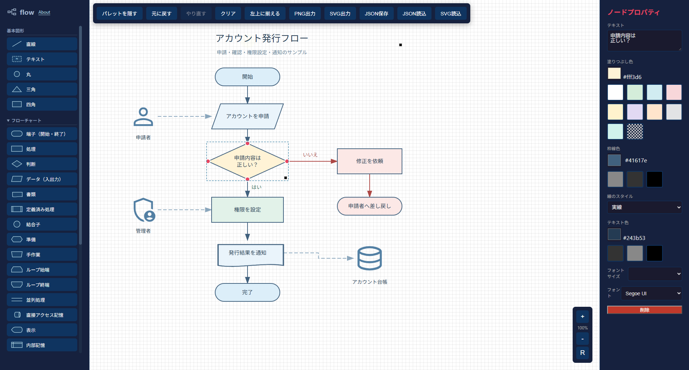

# flow

`index.html` だけで動作する、軽量でシンプルなフローチャート作成アプリです。  
インストールやビルドは不要で、ブラウザで `index.html` を開くだけですぐに使えます。

## 特徴

- 単一 HTML ファイルで動作
- ブラウザのみで利用可能
- 複数のフローチャート図形をドラッグ＆ドロップで配置
- 7グループ（インフラ・デバイス・システム・権限・安全・グラフ・ユーザ・文書・管理）のSVGアイコン計203点を内蔵し、ドラッグ＆ドロップで配置
- ノード同士の接続
- テキスト編集、色変更、サイズ変更、図形と接続線の線スタイル変更（実線・破線・点線）
- 図形の複数選択、一括移動・複製・削除、整列・等間隔配置
- Undo / Redo（直近100回の編集履歴）
- キャンバスのズーム、パン操作
- `JSON` 形式での保存、読込
- `PNG` / `SVG` 出力
- 外部 `SVG` の読込と再利用

## 画面イメージ



## 使い方

1. `index.html` をブラウザで開きます。
2. 左側の図形一覧からキャンバスへドラッグ＆ドロップします。
3. 図形を選択して、テキストや色、サイズなどを調整します。
4. ツールバーから保存、読込、画像出力を行います。

サンプルを見るには、「JSON読込」から `flowchart-sample.json` を選択してください。「アカウント発行フロー」が表示されます。

## 主な操作

- 図形追加: サイドバーからドラッグ＆ドロップ
- 図形の線スタイル: 図形を選択し、右側プロパティの「線のスタイル」で実線・破線・点線を選択。直線や読込SVGにも対応し、JSON保存・複製・Undo / Redo・PNG / SVG出力に反映（テキストボックスの枠線は従来どおり画像出力から除外）
- ノード移動: ドラッグ
- 複数選択: `Ctrl`（Mac は `Command`）または `Shift` を押しながら図形をクリック。選択済みの図形を同じ操作でクリックすると選択を解除
- 選択をすべて解除: 修飾キーを押さずに背景をクリック
- 範囲選択: `Shift`（または `Ctrl` / `Command`）を押しながら背景をドラッグし、枠内に完全に収まる図形を選択に追加。`Esc` で範囲選択をキャンセル
- 全図形を選択: `Ctrl+A`（Mac は `Command+A`）。テキスト編集中は通常の文字選択
- 一括操作: 複数選択した図形をドラッグしてまとめて移動。選択中の図形を右クリックすると、複数選択を保ったまま複製・削除・最前面／最背面への移動が可能
- 整列と配置: 複数選択後、右クリック →「整列と配置」→「左揃え」「横方向の中央揃え」「縦方向の中央揃え」「右揃え」「間隔を均等」
- 中央揃え: 「横方向の中央揃え」は左右の中心（X座標）をそろえて上下位置を維持し、「縦方向の中央揃え」は上下の中心（Y座標）をそろえて左右位置を維持。選択全体の範囲の中心を基準に配置
- 間隔を均等: 3個以上の図形を選択し、左右両端の図形を固定して横方向の空きを均等に配置。整列・一括移動時は接続線も追従
- ノード複製: コンテキストメニューから実行
- ノード削除: `Delete` / `Backspace`
- 元に戻す（Undo）: 「元に戻す」ボタン、`Ctrl+Z`（Mac は `Command+Z`）
- やり直す（Redo）: 「やり直す」ボタン、`Ctrl+Y` または `Ctrl+Shift+Z`（Mac は `Command+Shift+Z`）
- キャンバス移動: 背景部分をドラッグ
- パレットの表示切替: 「パレットを隠す」／「パレットを表示」
- 部品グループの展開: 基本図形は常に表示。「フローチャート」「インフラ」「デバイス」「システム」「権限・安全」「グラフ」「ユーザ」「文書・管理」は初期状態で折りたたまれており、見出しをクリックすると個別に展開・折りたたみできます。見出しにフォーカスして `Enter` / `Space` でも操作できます。
- 図の表示位置調整: 「左上に揃える」で、ズーム倍率を保ったままツールバーの下へ表示（図形の座標は変更しません）
- ズーム: 画面右下の `+` / `-` ボタンで倍率を変更し、`R` ボタンで倍率と表示位置をリセット
- 保存: `flowchart.json` として書き出し
- SVG読込: 任意の SVG ファイルを図形として追加
- About: 左上の「flow」の右にあるリンクから、日本語・英語のアイコン利用・ライセンス案内を表示。文中のリンクは別タブで開き、「閉じる」または `Esc` で閉じます。

## Undo / Redo

図形の追加・移動・サイズ変更・テキストや色の編集、接続線の追加・編集・削除、整列・配置、一括複製・削除、前面／背面への移動を取り消し・やり直しできます。JSON読込とキャンバスのクリアも対象です。

ドラッグやサイズ変更は操作全体を1回、同じプロパティ入力欄での連続入力はフォーカスが離れるまで1回の履歴として扱います。文字を編集中のショートカットは、入力欄の通常のUndo / Redoとして動作します。図形全体の編集を戻す場合はツールバーのボタンを使用してください。

履歴は直近100回まで、このページを開いている間だけ保持されます。JSONには履歴を保存しません。Undo後に新しく編集するとRedo履歴は破棄されます。選択・ズーム・パン・パレットの表示切替は履歴に含まれません。

## フローチャート部品

- 部品名と形状は JIS X 0121／ISO 5807 の記号を参考にしています。
- フローチャート部品の初期色は白地・黒線です。色はプロパティから変更できます。
- パレットでは基本図形・フローチャートを淡い青の輪郭、SVGアイコンを淡い青で表示します。フローチャート部品はキャンバスでは白地・黒線、SVGアイコンは黒で配置されます。
- ループ始端とループ終端には同じループ名を記入し、判定位置に応じて初期化・増分・終了条件を記入します。
- 並列処理は、二つ以上の並行する処理の同期を表します。
- 遅延・延期はフローチャートの欄に配置しています（JIS X 0121／ISO 5807 の規格外記号）。

既存の JSON ファイルも読み込めます。保存済みの色は維持され、ループ端と表示記号は修正後の形状で表示されます。

## ファイル構成

```text
.
├─ index.html
├─ README.md
├─ LICENSE
├─ .gitignore
├─ flowchart-sample.json
└─ images/
   └─ screenshot-overview.png
```


## 更新履歴

### 2026-10-12

- Initial release


## License

This project is licensed under the MIT License. See the [LICENSE](./LICENSE) file for details.

本アプリケーションは、Googleが提供する [Material Design Icons](https://fonts.google.com/icons) を使用しています。これらのアイコンは [Apache License Version 2.0](https://www.apache.org/licenses/LICENSE-2.0.html) の下で提供されています。
